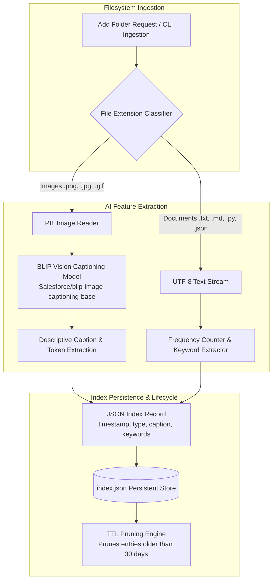

# 🔍 Semantic Search Tool (Finder)
### *Local AI-Powered Multimodal Semantic Search Engine for Images & Documents*

[](https://fastapi.tiangolo.com/)
[](https://www.python.org/)
[](https://pytorch.org/)
[](https://huggingface.co/)
[](https://huggingface.co/Salesforce/blip-image-captioning-base)
[](https://openai.com/research/clip)
[](https://tailwindcss.com/)
[](https://github.com/TJeyesh/Semantic-Search-Tool)
[](LICENSE)

---

## 📌 Executive Overview

**Semantic Search Tool** (internally nicknamed **Finder**) is a high-performance, privacy-first local search engine and file explorer designed for macOS and Windows. Traditional desktop search engines (such as macOS Spotlight or Windows Explorer) rely almost exclusively on exact file name matching or basic keyword indexing within text files. They fail when:

- Searching for images containing visual concepts without descriptive file names (e.g., finding `IMG_4821.JPG` by querying *"a cat resting on a rug beside a potted plant"*).
- Searching codebases, markdown documentation, or notes by thematic concepts rather than exact substring matches.
- Organizing and querying cross-platform file libraries with zero cloud dependency or privacy leaks.

**Semantic Search Tool** solves this by leveraging state-of-the-art multimodal deep learning models completely on-device. It runs both as a modern dark-mode **FastAPI web application** with instant background indexing and as an automated background daemon with sub-millisecond retrieval.

---

## 🚀 Key Features

- **🖼️ Deep Multimodal Vision Captioning (Salesforce BLIP)**:
  Automatically analyzes raster graphics (`.png`, `.jpg`, `.jpeg`, `.bmp`, `.gif`) using `Salesforce/blip-image-captioning-base` to generate rich, descriptive English captions describing scene content, objects, settings, and spatial interactions.
- **⚡ Direct Multimodal Vector Embeddings (CLIP & Sentence-Transformers)**:
  Embeds images into a shared semantic latent space with text queries using OpenAI's `clip-ViT-B-32`, alongside `all-MiniLM-L6-v2` for dense textual semantic representations and cosine similarity ranking.
- **📄 Deep Text & Code Indexing**:
  Parses documents and source code (`.txt`, `.md`, `.py`, `.js`, `.html`, `.css`, `.json`), extracting token frequencies, keyword hierarchies, and text previews.
- **💾 Persistent Inverted Index & Automatic TTL Pruning**:
  Stores processed metadata and captions locally in `index.json`. Includes automatic 30-day TTL lifecycle pruning to clean up stale or deleted files and prevent database bloat.
- **🎨 Modern Glassmorphism Web Interface**:
  Built with Tailwind CSS, featuring an ultra-responsive dark mode UI, real-time debounced search bar, responsive grid cards, badge chips, and full file preview modals.
- **🔄 Asynchronous Non-Blocking Folder Ingestion**:
  Add entire directories through the UI modal; analysis runs in FastAPI `BackgroundTasks`, keeping search responsive while heavy vision models process in the background.
- **🖥️ Cross-Platform Native Daemons**:
  - **macOS**: One-click `.command` launcher, automated shell installer (`setup.sh`), and `launchd` LaunchAgent daemon (`com.tamadajeyesh.finder.plist`) for automatic background startup on login.
  - **Windows**: Portable one-click batch scripts (`setup.bat`, `run_finder.bat`), bundled archive, and comprehensive Windows deployment guide.

---

## 🏗️ System Architecture

### 1. Ingestion & Indexing Pipeline



### 2. Search & Retrieval Pipeline


---

## 📁 Repository Structure

```
.
├── LICENSE                          # MIT License
├── README.md                        # Project documentation (this file)
├── .gitignore                       # Git ignore rules (virtual environments, caches, models)
└── semantic_search_tool/
    ├── semantic_search.py           # Standalone CLI vector search (CLIP + MiniLM)
    ├── run_finder.bat               # Windows root launcher
    ├── WINDOWS_README.md            # Windows setup guide
    ├── Windows.zip                  # Prepackaged Windows distribution bundle
    ├── Mac/                         # macOS Distribution & Daemon
    │   ├── app.py                   # FastAPI web service & REST endpoints
    │   ├── persistent_search.py     # BLIP vision captioning & persistent search engine
    │   ├── setup.sh                 # Automated macOS environment installer
    │   ├── install_autostart.sh     # Script to install macOS launchd LaunchAgent
    │   ├── run_finder.command       # Double-clickable macOS launcher
    │   ├── com.tamadajeyesh.finder.plist # macOS launchd daemon configuration
    │   ├── requirements.txt         # Python dependencies
    │   ├── index.json               # Persistent metadata index store
    │   ├── templates/
    │   │   └── index.html           # Dark-mode Tailwind CSS web interface
    │   └── test_data/               # Sample test fixtures (cat.png, hello.txt)
    └── Windows/                     # Windows Distribution
        ├── app.py                   # FastAPI web service
        ├── persistent_search.py     # Persistent search engine
        ├── setup.bat                # Automated Windows environment installer
        ├── run_finder.bat           # Double-clickable Windows launcher
        ├── requirements.txt         # Python dependencies
        ├── WINDOWS_README.md        # Windows instructions
        ├── templates/
        │   └── index.html           # Tailwind CSS interface
        └── test_data/               # Sample test fixtures
```

---

## 🛠️ Installation & Setup

### Prerequisites

- **Python 3.10, 3.11, 3.12, or 3.14**
- **pip** and **virtualenv**
- Recommended: 4GB+ RAM for running BLIP / CLIP vision models locally

---

### Option A: macOS Quick Start

#### 1. Automated Setup
Open Terminal, navigate to the `Mac` directory, and run the automated installer:
```bash
cd semantic_search_tool/Mac
chmod +x setup.sh
./setup.sh
```
This script will:
- Check for Python 3.
- Create a virtual environment (`venv`).
- Install all required dependencies from `requirements.txt`.
- Set execute permissions on launcher scripts.

#### 2. Launch the Application
Double-click `run_finder.command` in macOS Finder, or run in Terminal:
```bash
./run_finder.command
```
The server will start at `http://localhost:8000` and automatically open your default browser.

#### 3. (Optional) Enable Auto-Start on System Login
To run Finder as a background macOS service every time you log in:
```bash
./install_autostart.sh
```
Logs will be written to `/tmp/com.tamadajeyesh.finder.out`. To disable:
```bash
launchctl unload ~/Library/LaunchAgents/com.tamadajeyesh.finder.plist
```

---

### Option B: Windows Quick Start

#### 1. Automated Setup
1. Open PowerShell or Command Prompt inside `semantic_search_tool/Windows`.
2. Run the automated installer:
   ```cmd
   setup.bat
   ```
3. Wait for the dependencies (`torch`, `transformers`, `fastapi`, etc.) to finish installing.

#### 2. Launch the Application
Double-click `run_finder.bat`!
The script activates the virtual environment, launches the Uvicorn server, and opens `http://localhost:8000` in your web browser.

---

### Option C: Manual / Developer Setup

```bash
# 1. Clone repository
git clone https://github.com/TJeyesh/Semantic-Search-Tool.git
cd Semantic-Search-Tool/semantic_search_tool/Mac

# 2. Create virtual environment
python3 -m venv venv
source venv/bin/activate  # On Windows: venv\Scripts\activate

# 3. Upgrade pip and install dependencies
pip install --upgrade pip
pip install -r requirements.txt

# 4. Start the FastAPI server
uvicorn app:app --host 0.0.0.0 --port 8000 --reload
```

---

## 💻 CLI Usage

Semantic Search Tool can also be executed directly from the terminal without the web interface.

### 1. Persistent Search Engine (`persistent_search.py`)

**Analyze and index a directory:**
```bash
python persistent_search.py analyze /path/to/my/photos
```

**Search indexed files by keyword or concept:**
```bash
python persistent_search.py search "white cat on rug"
```

Output:
```text
Searching for key: 'white cat on rug'
Found 1 matches:
- [3] /Users/tjeyesh/Personal Folder/Work/finder/semantic_search_tool/Mac/test_data/cat.png
  a cat laying on a rug next to a plant
```

### 2. Direct Vector Semantic Search (`semantic_search.py`)

Using direct CLIP and Sentence-Transformers vector cosine similarity:
```bash
python semantic_search.py /path/to/search/folder --query "a furry animal in the living room"
```

---

## 🌐 REST API Reference

The FastAPI backend exposes the following endpoints:

| Method | Endpoint | Description |
| :--- | :--- | :--- |
| `GET` | `/` | Serves the interactive Tailwind CSS HTML search dashboard. |
| `POST` | `/api/index/add` | Enqueues a directory path for background analysis and indexing. |
| `GET` | `/api/search` | Performs real-time search across indexed files (`?q=<query>`). |
| `GET` | `/api/file` | Safely serves a file for inline viewing or download (`?path=<absolute_path>`). |
| `GET` | `/files/{filepath}` | Direct file retrieval endpoint. |

### Sample API Invocations

#### Add Folder to Index:
```bash
curl -X POST "http://localhost:8000/api/index/add" \
     -H "Content-Type: application/json" \
     -d '{"path": "/Users/username/Pictures"}'
```
Response:
```json
{
  "status": "started",
  "message": "Analysis started for /Users/username/Pictures"
}
```

#### Query Indexed Files:
```bash
curl "http://localhost:8000/api/search?q=cat"
```
Response:
```json
[
  {
    "path": "test_data/cat.png",
    "score": 3,
    "data": {
      "type": "image",
      "caption": "a cat laying on a rug next to a plant",
      "keywords": ["a", "cat", "laying", "on", "a", "rug", "next", "to", "a", "plant"],
      "timestamp": 1767505249.6358669
    }
  }
]
```

---

## ⚙️ Configuration & Customization

| Setting | Location | Default | Description |
| :--- | :--- | :--- | :--- |
| `image_model` | `semantic_search.py` | `clip-ViT-B-32` | Multimodal model for zero-shot text-to-image similarity. |
| `text_model` | `semantic_search.py` | `all-MiniLM-L6-v2` | Sentence transformer model for document embeddings. |
| `caption_model` | `persistent_search.py` | `Salesforce/blip-image-captioning-base` | Vision-language captioning model. |
| `max_days` | `persistent_search.py` | `30` days | Time-to-live threshold for automatic index pruning. |
| `image_extensions` | `persistent_search.py` | `.jpg`, `.jpeg`, `.png`, `.bmp`, `.gif` | File types recognized as images. |
| `text_extensions` | `persistent_search.py` | `.txt`, `.md`, `.py`, `.js`, `.html`, `.css`, `.json` | File types recognized as text. |

---

## 🔒 Privacy & Security

- **100% On-Device Processing**: All models run locally on your CPU or Apple Silicon / CUDA GPU. No images, text content, file paths, or search queries are ever transmitted to any remote cloud or external server.
- **Air-Gapped Operation**: Once model weights are cached from Hugging Face on initial launch, the system operates completely offline.
- **Local Network Safety**: Default binding is `localhost:8000`, safe for personal desktop environments.

---

## 📄 License

This project is licensed under the [MIT License](LICENSE) - see the [LICENSE](LICENSE) file for details.

---

## 👤 Author

Developed by **[Tamada Jeyesh](https://github.com/TJeyesh)**.
Contributions, issues, and feature requests are welcome!
